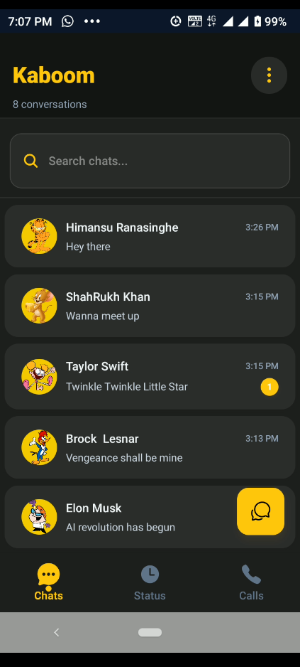
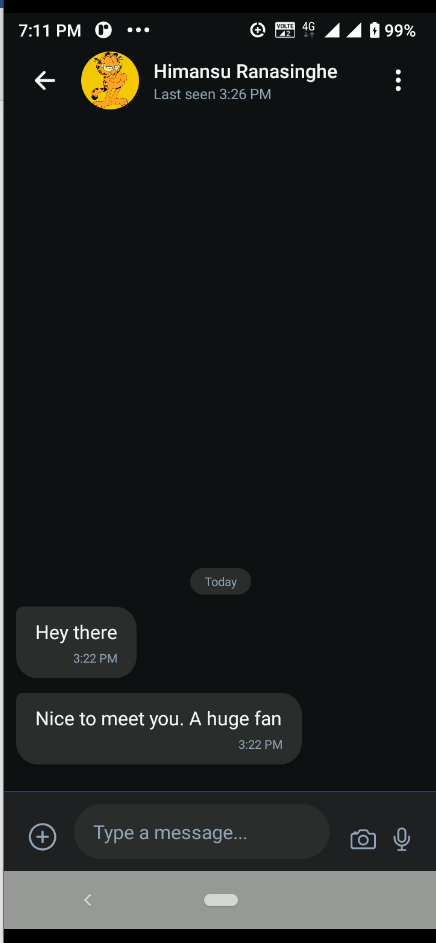
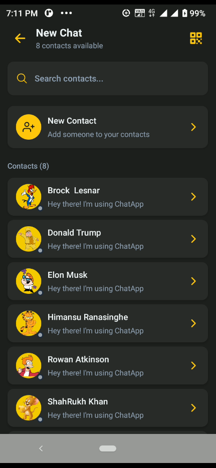
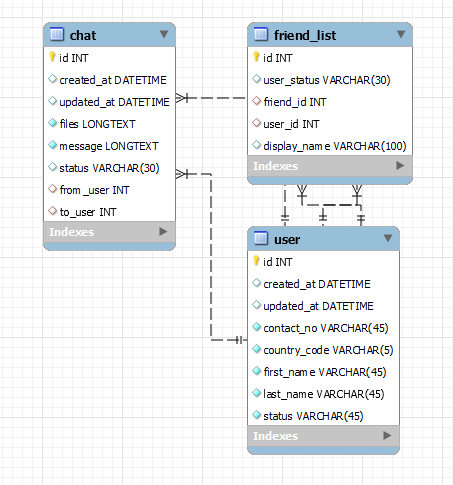

<h1 align="center">💥 Kaboom - Real-Time Chat App</h1>

  
  
  
  
  

  <strong>Kaboom</strong> is a mobile-first, real-time chat application built with React Native and a Java EE WebSocket backend. It supports account management, live presence tracking, and instant messaging.

> *Note: This is one of my early foundational projects, built to explore cross-platform mobile development, WebSockets, and REST API integration. It served as a stepping stone to my later enterprise-grade applications.*

---

## 📖 Overview

**Kaboom** is a full-stack chat application designed for seamless mobile communication. It features a React Native/Expo frontend that communicates with a Java EE backend via REST servlets for account/profile operations and WebSockets for live, bidirectional chat and contact updates. 

Data is persisted in a MySQL database using Hibernate ORM, while profile images are handled via static file URLs.

## ✨ Key Features

### 📱 Accounts & Profiles
- Phone-number-based registration and sign-in.
- Duplicate phone-number prevention.
- Persistent local user ID via `AsyncStorage`.
- Profile image/avatar selection.
- Light, dark, and system theme modes.

### 💬 Real-Time Chat
- One-to-one WebSocket messaging.
- Persistent chat history and recent chat lists.
- Unread message counts and message statuses (`SENT`, `DELIVERED`, `READ`).
- Live online/offline presence tracking.
- Contact management with custom local display names.

## 🛠️ Technology Stack

| Category | Technologies |
| :--- | :--- |
| **Frontend** | React Native, Expo, TypeScript, React Navigation, NativeWind (Tailwind) |
| **Backend** | Java 8 (Java EE 8), Servlets, Java WebSocket API |
| **Database** | MySQL 8.0, Hibernate 4.3, C3P0 |
| **Server** | GlassFish 5, NetBeans Ant |
| **Networking** | ngrok (for HTTPS/WSS external exposure) |

## 📸 System Showcase

| Home Screen | Chat Interface | Contacts | Sign In |
| :---: | :---: | :---: | :---: |
|  |  |  |  |

## 🗄️ Database Schema

The application uses a MySQL database named `kaboom` with the following core Hibernate entities:

- **`User`**: Identity, phone number, status (Online/Offline), and bio.
- **`Chat`**: Individual messages, sender/recipient, text, status, and timestamps.
- **`FriendList`**: Contact mappings (Owner user, Friend user, display name).
- **`Status` (Enum)**: Centralized enum for `ACTIVE`, `BLOCKED`, `DELIVERED`, `READ`, `SENT`, `ONLINE`, `OFFLINE`.

**Entity-Relationship Diagram:**

  

## 🏗️ System Architecture

The project is a client-server monolith divided into two main directories:
1. **Frontend (`/Frontend`):** Expo/React Native application.
2. **Backend (`/Backend`):** Java EE WebSocket server and servlet API.

Real-time operations flow through the `/Kaboom/chat?userId=<id>` WebSocket endpoint, while Hibernate handles the transactional persistence to MySQL. 

## 🚀 Known Limitations & Future Enhancements

*(Note: As an early foundational project, the following production-level improvements were identified for future iterations).*
- [ ] **Security:** Implement password hashing and OTP verification (current auth is phone-number identification only).
- [ ] **Security:** Secure WebSocket connections with JWTs to prevent `userId` spoofing.
- [ ] **Security:** Remove hardcoded database credentials from `hibernate.cfg.xml`.
- [ ] **Features:** Implement the placeholder screens (Calls, Status, Settings).
- [ ] **Infrastructure:** Replace hardcoded ngrok URLs with dynamic environment variables.

## 👨‍💻 Author

**Himansu Nethsara Ranasinghe**
- 🎓 BSc (Hons) Software Engineering Undergraduate (JIAT / BCU)
- 🔗 [LinkedIn](https://www.linkedin.com/in/himansu-nethsara/)
- 🐙 [GitHub](https://github.com/HimansuNethsara)